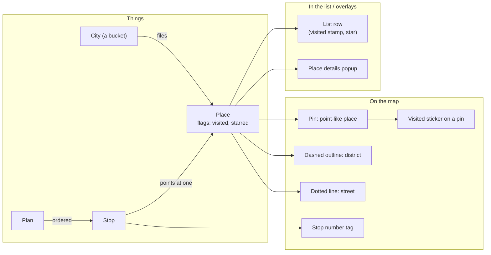
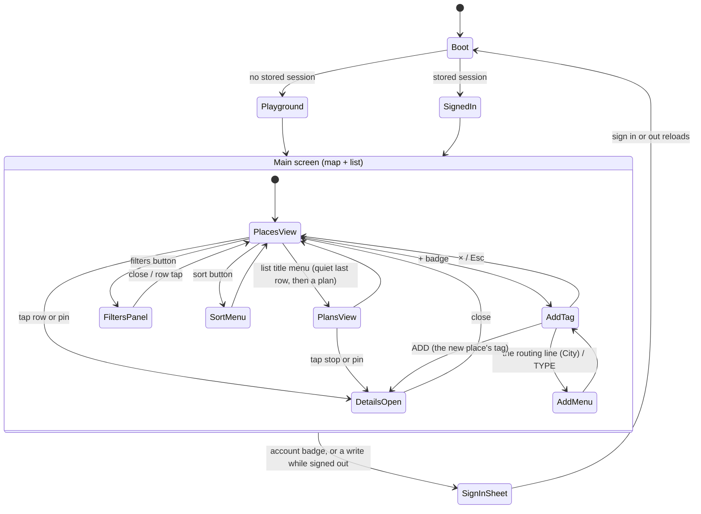
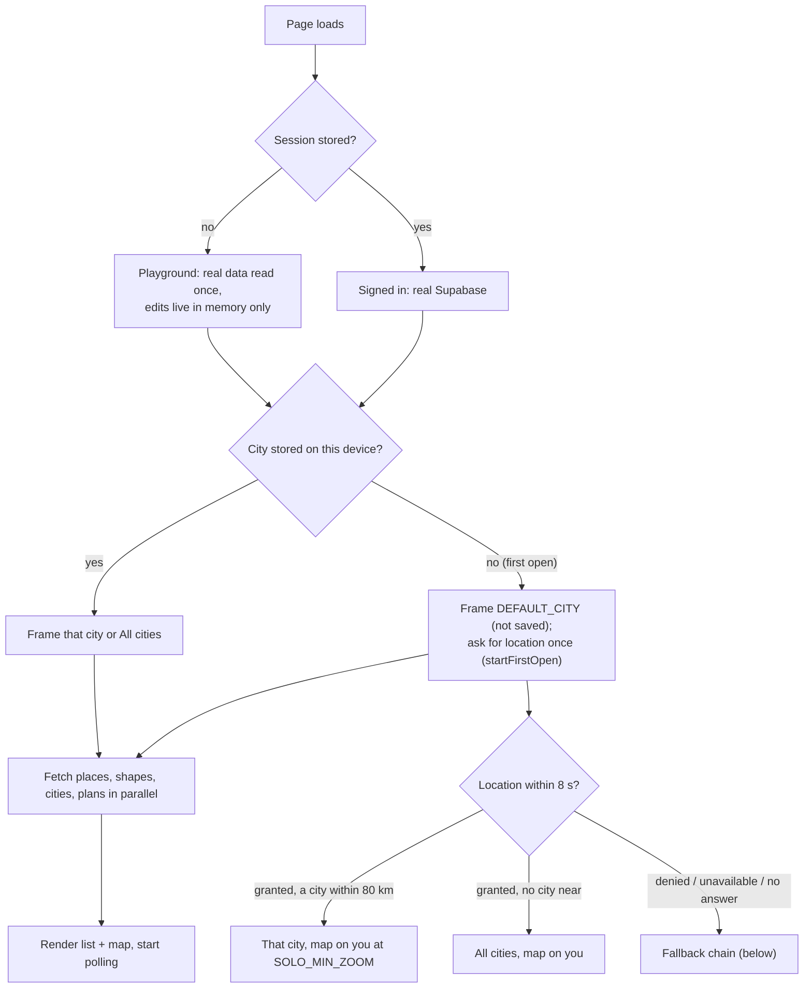
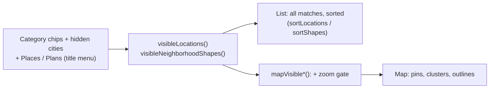
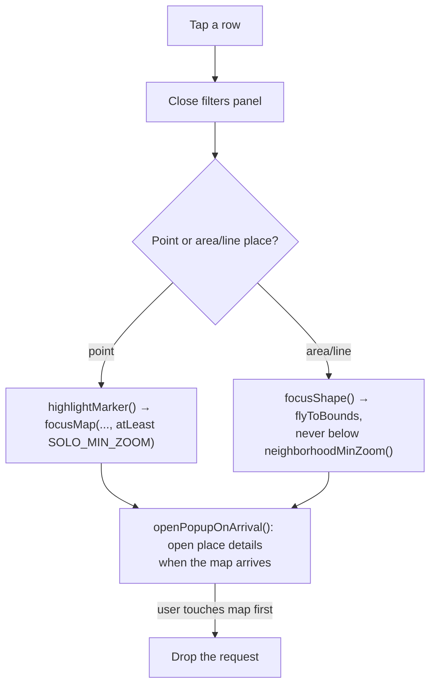
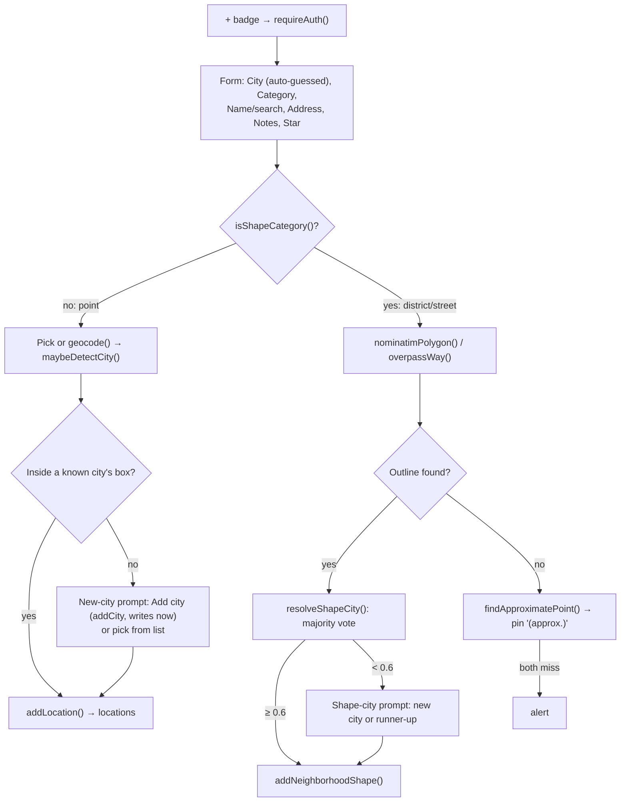
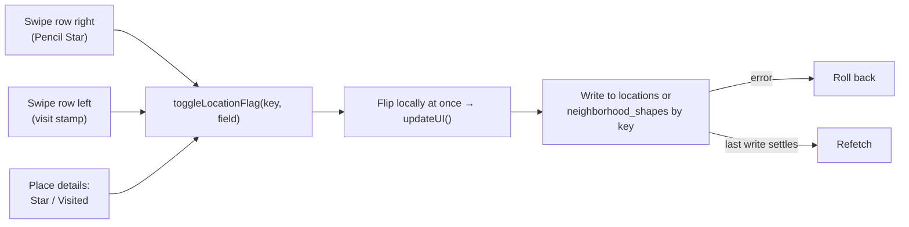
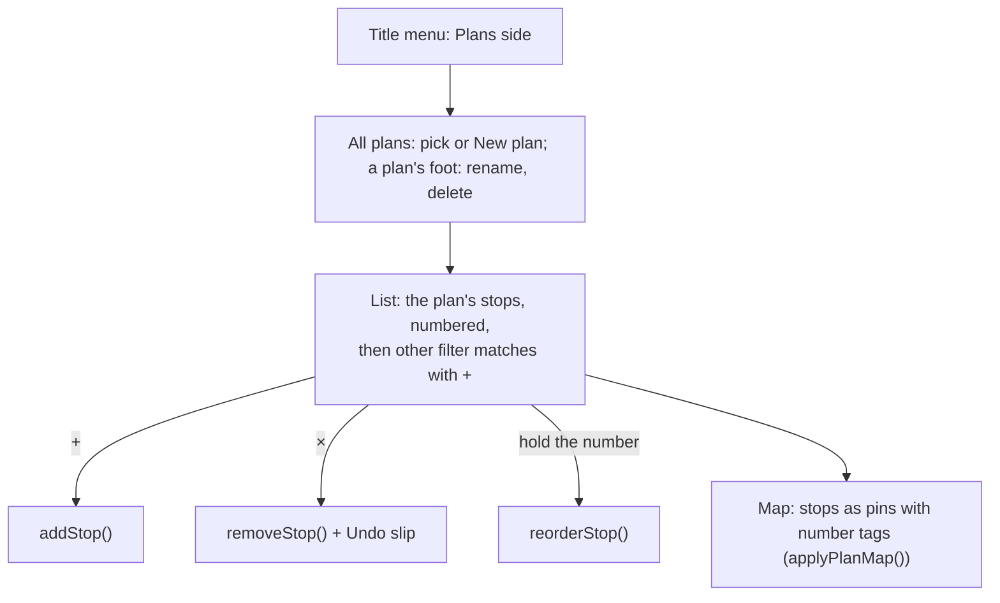
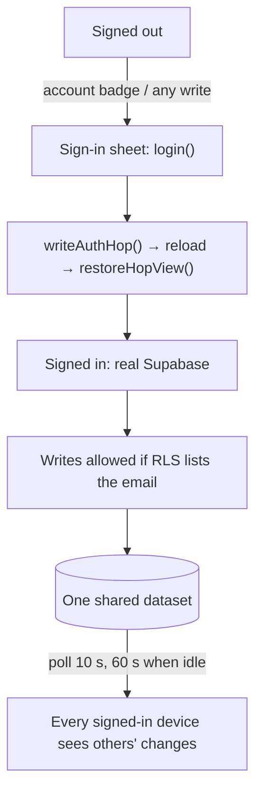
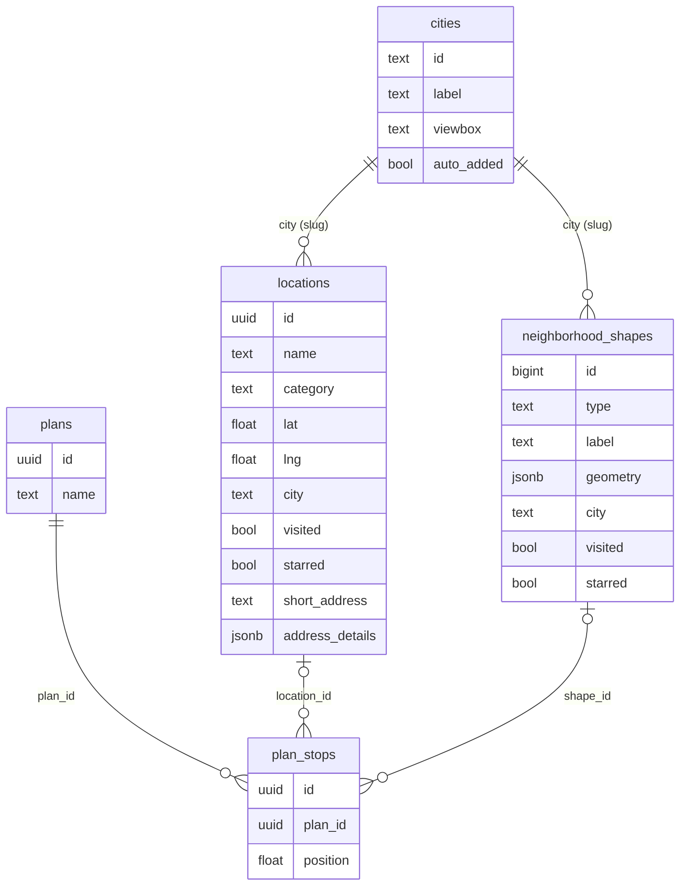

# Triplet: how the app works

**Purpose:** get a new agent oriented in ten minutes: what the user handles,
what screens and flows exist, and where each lives in `index.html`. Rules and
gates: `CLAUDE.md`. Feature specs and history: `docs/shipped.md`. This file
points to them and doesn't restate them.

Code claims were checked against `index.html` on main (2026-10-15). Names are
grep-able; there are no line numbers. **Unclear** marks what couldn't be
confirmed.

Triplet is a private trip-planning map (Iceland/Scandinavia, Sept 2026, plus
LA), used mostly on an iPhone. Jobs: **collect** places, **browse** them by
city on a map and a list, **go** (directions, mark visited, star), **plan**
ordered stops, and **share** one dataset with every signed-in editor.
Adding is **places-first**: log the place now, structure follows
(`design/trip-location-model/owner.md`).

---

## 1. Object model: things vs. their representations

The **place** is the thing. A pin, a district outline and a street line are
*representations* of a place, chosen by its physical presence (a point, an
area, a line). The list row, the details popup, the stamp and the sticker are
more representations of the same place.

| Thing | What it is | Representations | In code |
|---|---|---|---|
| **Place** | Somewhere worth going. Has a city, category, name, notes, `visited`, `starred` | Pin, district outline or street line on the map; list row; place details | **Two tables for one concept:** `locations` (point places) and `neighborhood_shapes` (district/street places). The code calls the second kind a "shape". `rowItem()` / `shapeRowItem()` give both one interface, keyed by uuid or `'shape:<id>'` |
| **City** | A bucket a place is filed under. Not a boundary | City section in the list (header, eye); a row in the list title's menu; the add tag's routing line | `cities` table merged into the static `CITIES` seed |
| **Plan** / **stop** | A named, ordered list; a stop points at exactly one place | Numbered rows in Plans; number tags on the map | `plans`, `plan_stops` (`location_id` **or** `shape_id`) |
| **Category** | The kind of place (11) | Glyph badge and ink on pins; filter chips | `CATEGORY_COLORS` |
| **Visited / starred** | Flags on a place | Row: stamp (`.row-stamp`), orange star. Pin: peeled sticker (`STICKER`), star | boolean columns on both tables |

**Place details** is the popup that opens for a place: name, address, notes,
type, Directions / Star / Visited. Its visual metaphor is a **Hanging Tag**
(a luggage tag), which is why the code says `TagPopup` and
`buildPopupHtml()`.

How the representation is chosen: category `district` or `street` means an
area/line place (`isShapeCategory()`), fetched from OSM at add time. If OSM
has no outline, the place is saved as a pin with that category and
`" (approx.)"` on its label (`findApproximatePoint()`).

---

## 2. Screen and state map

One screen: the map, with the list as a bottom sheet (a left rail at
≥900px, `railQuery`). Everything else is a layer on it.

| Layer | Opens from | Element / function |
|---|---|---|
| List (Places) | always | `#locationsList`, `syncLocationCards()` + `syncShapeCards()` |
| List (Plans) | the list title's menu (its last row, then a plan or All plans) | `syncPlanCards()` (a plan: legs, foot, add-from sections), `syncPlansList()` (All plans) |
| Filters panel | `#toggleFiltersBtn` | `createFilters()` (category chips only) |
| List title menu | `#titleBtn` | `openTitleMenu()`, `renderTitleMenu()`, `placeTitleMenu()` (`menuLock`), `goToCity()`, `choosePlan()`, `showAllPlans()` |
| Sort menu | `#sortBtn` | `SORT_MODES`, `setSortMode()` |
| Place details | row tap, pin tap | `buildPopupHtml()`, `TagPopup`, `tagOpened()` / `tagClosed()` |
| Add tag (add-tag-jam phase 2) | + badge `#floatingAddBtn` | `#addForm` (a fixed card built from the tag's `.tag-*` parts), `openAddForm()`, `cancelAddForm()`, `renderAddTag()`, `placeAddTag()`, the wash `#addWash` |
| Add tag menus | the routing line, TYPE | `#addCityMenu`, `#addTypeMenu`, `openAddMenu()` (the shared `.menu-box`) |
| Sign-in sheet | `#accountBtn`, or `requireAuth()` | `showAuthModal()`, `login()` |
| Locate | `#centerMeBtn` | `centerOnUserLocation()` |
| Error banner | any failure | `showError()` / `hideError()` (by source) |

---

## 3. Main flows

### Open

**First open** (no city stored on this device, and not a sign-in/out
reload): `startFirstOpen()` asks for the location once at boot, the app's
only location request on load. Granted: within 80 km
(`FIRST_OPEN_NEAR_KM`) of a city's centre, that city, the map on the user
at `SOLO_MIN_ZOOM` with the "you are here" dot; otherwise All cities,
centred on the user. Denied, unavailable or no answer in 8 s
(`FIRST_OPEN_WAIT_MS`): silent (no error banner), and
`firstOpenFallbackCity()` picks:

1. the city of the most recently added place (`locations` arrive
   `created_at` DESC). The data is shared today; with per-person accounts
   this becomes the user's own newest place;
2. no places: the known city nearest the device's time zone
   (`Intl...timeZone` → `TZ_POINTS`, no permission or network);
3. otherwise `DEFAULT_CITY` (LA).

The result is saved, so the next open restores it like any returning
device. The map moves at most once after the boot frame: if the data lands
before the answer, the fallback snaps in (no animation); a fix that comes
later flies there once, even after the 8 s, unless the user has touched the
page. Later, location is used only by the locate button
(`centerOnUserLocation()`, zoom 14) and the Nearest sort; a saved Nearest
sort resumes on load only if permission is already granted.

### Browse and filter

- Filters decide what **both** list and map show. Sort only reorders the
  list. Zoom only thins the map. Never use a `mapVisible*` function for list
  membership (CLAUDE.md).
- Going to a city (title menu, a section header's name) calls `goToCity()` -> `setActiveCity()`:
  it frames the city and scrolls the WHOLE list to its section header; it never filters.
  Hiding is separate: a section header's eye, `setCityHidden()`, `hiddenCities` (per viewer,
  `localStorage` `triplet.hiddenCities`). Phase 1 of `design/add-tag-jam/handoff.md`.
  Re-picking the current city reframes it (the recovery after panning away).
  Category chips survive a go-to.

### List tap → map

Newest tap wins. The selected row (navy) follows the open details; closing
them clears it (`setHighlighted()`). Tap a pin: details open. Tap a cluster:
zoom in (it never expands in place).

### Add a place

| Detail | Behaviour |
|---|---|
| City field default | `defaultFormCity()`: the active city, or in All cities the nearest to the map centre within 150 km |
| While typing | `currentSearchCityConfig()` scopes search to the city nearest the map centre (75 km), else the viewport |
| Manual city pick | sets `userOverrodeCity`; auto-guessing stops for this form session |
| Search widens | `nominatimWithFallback()`: one wider search only on zero results, 1 s spacing (`NOMINATIM_SPACING_MS`) |
| Area/line city | never from the form; `resolveShapeCity()` votes per point (`SHAPE_CITY_CONFIDENT_SHARE` 0.6) |
| After saving | only the city (phase 3: the Hanging Tag's routing line); not the name, notes or category. Backlog: "Edit a place after adding it" |
| Orphan cities | `cleanupOrphanCities()` (boot, after delete) removes auto-added cities nothing references; never the seed five |

### Mark visited / star, delete

Animations follow the state change, never the gesture code (CLAUDE.md).
With no `currentUser`, the details' Star/Visited are `aria-disabled` and
offer a sign-in slip (`showTagSlip()`); the playground's guest counts as a
user, so there they work (in memory). Directions open Apple Maps (`directionsUrl()`).
Delete: the row's × on a near-still tap (`DELETE_TAP_SLOP`) →
`confirmDelete` / `confirmDeleteShape` (warns if the place is a plan stop).

### Plans

The corner + still adds a *place*, not a stop. Spec: `docs/shipped.md`
"Plans (v3 build)", `design/plans-deepdive/v3/`.

### Sign-in and sharing

- **Sharing is the whole dataset**, not per user: every place, flag, city and
  plan is shared. Anyone signed in reads it; writes are allowed for the
  emails in the RLS policies (today the owner and Erica).
- Changes arrive by **polling**, no realtime: `pollTick()` every
  `POLL_ACTIVE_MS` (10 s), `POLL_IDLE_MS` (60 s) after `IDLE_AFTER_MS`
  (2 min) idle; paused while the page is hidden, refetched on return
  (`visibilitychange`).
- **Signed out = playground** (`PLAYGROUND`, `createPlaygroundClient()`): a
  snapshot read once at boot; edits stay in memory and a reload resets them.
  Polls hit that copy, so others' changes don't arrive until sign-in.

---

## 4. Data model

| Note | |
|---|---|
| `locations` + `neighborhood_shapes` | Both are **places**; split by representation, not by concept |
| `geometry` | Array of **`[lat, lng]`**, not GeoJSON |
| `plan_stops` | Exactly one of `location_id` / `shape_id` (CHECK); deletes cascade |
| RLS | Same on all tables: public `SELECT`; writes only for the listed emails |
| Schema drift | `20260918000000_add_city_to_locations.sql` adds a CHECK on `locations.city`; the live DB has none (checked 2026-10-15). **Unclear** how it was dropped |
| Fail-soft | Missing `short_address` columns: reads/inserts retry without them. Missing plans tables: `plansAvailable === false` |

Schemas: `supabase/migrations/`. Project `jgvckilmltimabfdvaly` (Supabase MCP).

---

## 5. Code map (`index.html`, top to bottom; grep the names)

Stack: one file (CSS, markup, one `<script>`), **no build step, ever**.
Leaflet 1.9.4, supabase-js 2.39.3, OSM raster tiles. GitHub Pages deploys
`main`.

| Area | Key names |
|---|---|
| Client, playground | `PLAYGROUND`, `createPlaygroundClient()`, `supabaseClient` |
| Config, state | `CATEGORY_COLORS`, `CITIES`, `SEED_CITY_IDS`, `DEFAULT_CITY`, `ALL_CITIES`, `locations`, `neighborhoodShapes`, `filters`, `citySelection`, `activeCity` |
| Row keys (one interface for every place) | `rowItem()`, `rowKey()`, `shapeRowItem()`, `shapeAnchor()` |
| Auth | `checkAuth()`, `showAuthModal()`, `login()`, `logout()`, `requireAuth()`, `writeAuthHop()`, `restoreHopView()` |
| Reads/writes | `fetchLocations()`, `fetchNeighborhoodShapes()`, `addLocation()`, `addNeighborhoodShape()`, `deleteLocation()`, `deleteNeighborhoodShape()`, `toggleLocationFlag()` |
| Geocoding | `nominatim()`, `nominatimWithFallback()`, `nominatimPolygon()`, `overpassWay()`, `findApproximatePoint()`, `geocode()`, `deriveShortAddress()` |
| City state | `setActiveCity()` (sole writer), `visibleLocations()`, `focusMap()`, `focusCity()` |
| City detection | `detectCityContext()`, `matchCity()`, `maybeDetectCity()`, `resolveShapeCity()`, `deriveNewCityConfig()`, `addCity()`, `fetchCities()`, `cleanupOrphanCities()` |
| Poll, locate | `startPoll()`, `pollTick()`, `noteInteraction()`, `centerOnUserLocation()` |
| Pins | `SOLO_MIN_ZOOM`, `GLYPH_MIN_ZOOM`, `badgeHtml()`, `markerIcon()`, `STICKER` |
| Place details | `buildPopupHtml()`, `TagPopup`, `tagAddress()`, `openPopupOnArrival()`, `highlightMarker()`, `setHighlighted()` |
| Sort | `SORT_MODES`, `sortLocations()`, `sortShapes()`, `heldOrder()`, `startNearest()` |
| Plans | `fetchPlans()`, `createPlan()`, `addStop()`, `removeStop()`, `reorderStop()`, `syncPlanCards()`, `applyPlanMap()`, `initPlans()` |
| Render | `updateUI()` (the single re-render), `syncLocationCards()`, `syncShapeCards()`, `syncMarkers()`, `syncClusterMarkers()`, `syncNeighborhoodLayers()`, `focusShape()` |
| Row gestures | `attachStarGesture()`, `beginVisitDrag()`, `settleVisitDrag()`, `DELETE_TAP_SLOP`, `stampTilt()` |
| Add tag | `addDraft`, `openAddForm()`, `cancelAddForm()`, `searchAddress()` / `rankSearchResults()`, `selectAddress()` (the pick), `osmToType()`, `preGuessCity()` / `guessCity()`, `addDistanceText()`, `alignMapToPin()`, `submitAddTag()` → `handleAddLocationSubmit()` / `handleAddShapeSubmit()`, `finishAdd()`, `clearAddDraft()` |
| Boot | `L.map(...)`, `tagOpened()`, `tagClosed()`, `restoreCitySelection()`, the `Promise.all` of the four fetches, `startPoll()` |

State notes: data arrays are always fetched **in full** and filtered on the
client. Reconcilers diff by signature (`markerSignature()`,
`cardSignature()`, `payloadDigest()`), so an unchanged poll touches nothing;
fetched rows aren't applied while `flagWritesInFlight > 0`. Per-device
`localStorage`: `triplet.citySelection`, `triplet.sortMode`,
`triplet.listView`, `triplet.activePlan`, `triplet.reorderHint`;
`sessionStorage` `triplet.authHop`.

| Service | Used by | Note |
|---|---|---|
| Supabase | everything | the only backend |
| Nominatim | `nominatim()`, `nominatimPolygon()`, `nominatimReverse()` | ≤ 1 req/s |
| Overpass | `overpassWay()`, `findApproximatePoint()` | streets, node fallback |
| Apple Maps | `directionsUrl()` | link out |

The sandbox can't reach Supabase, Nominatim or Overpass: use the Supabase MCP;
live-OSM work runs in the owner's browser. `tools/*.html` are standalone
pages for that (`neighborhood-shapes.html`, `short-address-backfill.html`;
the `geocoder*.html` pages are historical).

---

## 6. City buckets (add-tag-jam phase 3; landed 2026-10-19)

No trip entity (owner, 2026-10-15: "drop"). A place sits in one city bucket guessed from the pin: the nearest city whose stored `center` is within `CITY_REACH_KM` (70, "we think"; `guessCity()`), else a new city named from the real town (`townOf()` of the pick's details, else of `nominatimReverse()` on the point; `guessCityAt()`), else -- no town anywhere -- the nearest city however far. Boxes (`viewbox`) no longer file anything: they decide only the distance note (`placeDistanceText()`). Editable at add (the add tag's routing line) and later (the Hanging Tag's routing line -> the city menu -> `setPlaceCity()`, a `city` update on `locations` / `neighborhood_shapes`; "+ town" runs `addCity()` first; `cleanupOrphanCities()` after). The pin never moves: the city is a filing, not a location.
A place shows both its app city (the routing line) and its real town (the address line, `tagAddress()`), plus "≈ N km from City" at the end of the address line when it lies outside its city's box (owner: "the address needs to comfortably balance the idea of the city it belongs to in the app vs the city the address actually places it").
A repeat visit to a place doesn't change its pins. Whether the city filter becomes multi-select is not decided. No DB change: the columns and RLS already allowed it.
Read `design/trip-location-model/concepts/5-city-buckets-trip-tags.md` (its trip parts are dropped) and `design/trip-location-model/owner.md` before touching it.

---

## 7. Gotchas

Load-bearing constants and gates: CLAUDE.md, "Load-bearing gates and
constants" (not copied here). Not obvious from the code:

- `setActiveCity()` deliberately has no early return on an unchanged city.
- Shape geometry is `[lat, lng]`; GeoJSON is converted on the way in.
- Duplicated ports (no build step): `deriveShortAddress()` and the shape city
  resolution also live in `tools/`. Change both copies.
- `CITIES` is mutated at runtime; `SEED_CITY_IDS` are never deleted.
- `addCity()` writes immediately; the add tag calls it only at ADD (a NEW city), so an abandoned tag makes nothing.
- The add tag is not a Leaflet popup: it's a card in the screen's frame, and the map moves under it (`alignMapToPin()`) so the picked place sits under its pin. While it's up a blocker (`#addWash`) keeps the map from being dragged.
- The playground looks fully functional: a signed-out "save" saved nothing.
- Place-details HTML is a string; its buttons use one delegated listener on
  Leaflet's `popupPane`. Don't attach per-button listeners.
- Numbers in `docs/` are Chromium-only; iPhone behaviour is unverified until
  the owner checks.

## 8. What to read for what

| Need | Read |
|---|---|
| Rules, lanes, gates | `CLAUDE.md` |
| A feature's spec and history | `docs/shipped.md` (later entries win) |
| Open work | `docs/backlog.md` |
| Owner-only iPhone checks | `docs/iphone-checks.md` |
| Taste rules | `docs/owner-taste.md` |
| UX / CD briefs | `docs/ux-brief.md`, `docs/cd-brief.md` |
| Design records, visual language | `design/<feature>/`, `design/inspo/project/` |
| Gesture tests, UI gate | `design/gesture-harness/`, `design/impeccable-gate/` |
