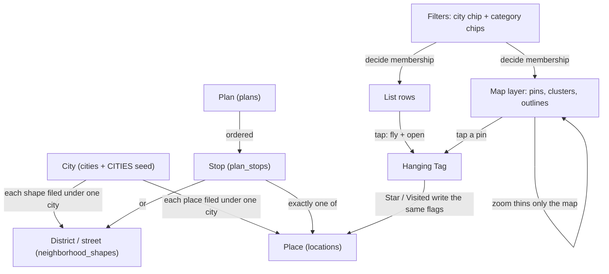

# Triplet: UX model and architecture

A map for an agent who has never seen this app. It explains what the app is,
what the user handles, and how `index.html` makes it happen. Rules and
load-bearing gates live in `CLAUDE.md`; feature specs and history live in
`docs/shipped.md`. This file points to them and doesn't restate them.

Every code claim here was checked against `index.html` on main (2026-10-15).
Function names are given so you can grep them. There are no line numbers
because they go stale. Where something couldn't be confirmed, it says
**unclear**.

---

## 1. What the app is for

Triplet is a private trip-planning map for two people: the owner and his
wife, Erica (the two emails in the RLS policies). Their main trip right now is
Iceland and Scandinavia in September 2026 (Reykjavík, Copenhagen, Malmö,
Stockholm), plus LA. The owner mostly uses it on an iPhone, often as a
home-screen web app.

The core jobs:

1. **Collect** places worth going to: restaurants, cafés, bars, sights,
   nature, shops, hotels, and whole districts or streets. Each one is filed
   under a city.
2. **Browse** them for a city, on a map and in a list together, filtered by
   category and sorted (A–Z, category, nearest, what's left, starred,
   newest).
3. **Go**: tap a place to see its card (the Hanging Tag), get directions in
   Apple Maps, and mark it **visited** or **starred**.
4. **Plan**: make named, ordered lists of stops (Plans) and follow them on
   the map.
5. **Share between two phones**: both people see each other's changes, which
   arrive by polling.

The owner's design principle for adding things is **places-first**. You do
the thing you came to do (log a place) right away, and structure follows
from it. There's no setup before the first place (see
`design/trip-location-model/owner.md`).

---

## 2. The UX model

### Objects

| Object | What the user sees | Stored in |
|---|---|---|
| **Place (pin)** | A category badge on the map and a row in the list | `locations` |
| **Shape** (district or street) | A dashed outline or dotted line on the map, and a row in the list | `neighborhood_shapes` |
| **City** | A city chip in the filter panel, and the City field in the add form | `cities` + the static `CITIES` seed |
| **Category filters** | 11 chips (`CATEGORY_COLORS` keys) in the filter panel | in memory (`filters.categories`) |
| **The list** | The bottom sheet on a phone, a left rail at ≥900px (`railQuery`). Its header shows "<City> list (N)" plus sort, filters and locate | DOM `#locationsList` |
| **The map** | Leaflet with OSM tiles. Pins, clusters and shape outlines | — |
| **Hanging Tag** | A place's popup card: name, address, notes, type, Directions / Star / Visited | built by `buildPopupHtml()`, class `TagPopup` |
| **+ add form** | The + badge (`#floatingAddBtn`) opens the form on the list's band | `#addForm` |
| **Plan** | A named, ordered list of stops. Each stop is a place or a shape | `plans`, `plan_stops` |
| **Visited / starred** | A flag on each place or shape: a stamp on rows, a sticker on pins, orange stars | boolean columns |
| **Sign-in / playground** | The account badge (`#accountBtn`). Signed out, the app is a playground | Supabase auth |

### How the objects relate

- A city is a **bucket**, not a boundary. A place sits in one city, chosen
  when it was added. Today that choice can't be changed afterwards because
  places can't be edited.
- A shape is treated like a place everywhere: it gets the same row, the same
  gestures, the same tag, visited and starred. In code it's dressed as a
  place by `shapeRowItem()` and keyed `'shape:<id>'` (see §3, "Row keys").
- The city chip, the category chips and the Places | Plans switch decide what
  the list **and** the map show. Sort only reorders the list. Zoom only thins
  the map.
- The selected row (navy) follows the open tag. Opening a tag selects its
  row, and closing the tag clears the selection (`tagOpened()` and
  `tagClosed()` call `setHighlighted()`).

### Main flows

- **Open.** The app boots in the last city chosen on this device
  (`restoreCitySelection()`, default `la`). It loads places, shapes, cities
  and plans in parallel, then polls (§3, "Sync"). If no session is stored, it
  boots as the **playground** (§3, "Auth").
- **Browse / filter.** The filter panel (`#toggleFiltersBtn`) holds the
  Places | Plans switch, the plan picker, the city chips (one per city plus
  "All cities") and the category chips. A city chip calls `setActiveCity()`,
  which reframes the map and refilters. Tapping the active city again
  reframes it on purpose: that's how you recover after panning away. Category
  chips survive a city switch. Sort is the `#sortBtn` menu (`SORT_MODES`);
  "Nearest" asks for location only when it's chosen.
- **Tap a list item → map.** The map pans and zooms far enough to see the
  item, from any zoom, and its Hanging Tag opens when the map arrives. This
  is a UX invariant (CLAUDE.md, "UX principles"). Pins use
  `highlightMarker()` → `focusMap(..., { atLeast: SOLO_MIN_ZOOM })`. Shapes
  use `focusShape()`, which flies to the shape's bounds and never lands below
  `neighborhoodMinZoom()`. Both go through `openPopupOnArrival()`, which opens
  the tag only once the map has actually arrived. It drops the request if the
  user touches the map first, and the newest tap wins. A row tap also closes
  the filter panel first.
- **Tap a pin** opens its tag. **Tap a cluster** zooms in (it never expands
  in place).
- **Hanging Tag.** Directions opens Apple Maps (`directionsUrl()`). Star and
  Visited toggle the flags. When signed out, those two are `aria-disabled`
  and offer a sign-in slip (`showTagSlip()`). The address line is
  `tagAddress()`: `short_address`, else derived from `address_details`, else
  nothing. Shapes show no address.
- **Mark visited / star.** There are three ways in:
  - Swipe a row **right** for the Pencil Star (`attachStarGesture()`).
  - Swipe a row **left** to stamp it visited.
  - Tap the tag's segments.

  All three end in `toggleLocationFlag(id, field)`. That flips the flag
  locally at once (`setLocationFlag()` → `updateUI()`), writes it, rolls back
  on error, and re-reads only after the last write in flight settles
  (`flagWritesInFlight`). Animations are driven by the state change, never by
  the gesture code (CLAUDE.md, "Animation separation").
- **Delete.** Tap the row's × (it fires only on a near-still tap,
  `DELETE_TAP_SLOP`). The handler is `confirmDelete` / `confirmDeleteShape`,
  and the confirm warns if the place is a plan stop.
- **Add a place.** See §3, "Adding, end to end".
- **Plans.** Switch to Plans in the filter panel. The picker creates, picks,
  renames and deletes plans. In Plans, the list shows the open plan's stops
  in order (numbered), then the other places that match the filters, each
  with a + to add it as a stop. A stop shows × to remove it, with an Undo
  slip. Holding a stop's number reorders it. The map draws stops as pins with
  number tags. + in the corner still adds a *place*, not a stop. Full spec:
  `docs/shipped.md` "Plans (v3 build…)" and `design/plans-deepdive/v3/`.
- **Sign in.** Tap the account badge for the sign-in sheet
  (`showAuthModal()` / `login()`). Signing in or out reloads into the other
  mode and lands back on the same view (`writeAuthHop()` /
  `restoreHopView()`).

### UX invariants (the source is CLAUDE.md "UX principles")

1. **The list shows everything that matches the active filters.** Zoom, pan
   and viewport never change list membership; they only thin the map.
2. **Every list item navigates the map to itself and opens its tag on
   arrival**, from any zoom. Any new kind of list item needs the same
   behaviour.
3. **The category chips are independent of the add form's category
   dropdown.**
4. **The list and the map always show the same set** (apart from the
   map-only zoom thinning). This is why any future trip filter must filter
   both at once.
5. **Any new visual look goes to the owner before it lands** (CLAUDE.md,
   "Team process").

---

## 3. Architecture

### Stack and deploy

- One file, `index.html`: CSS in one `<style>`, then the markup, then one
  `<script>`. There's **no build step, and that's permanent**.
- Leaflet 1.9.4 (unpkg) and supabase-js 2.39.3 (jsdelivr). Tiles are standard
  OSM raster (`tile.openstreetmap.org`), re-toned by a CSS filter on the tile
  pane only.
- GitHub Pages deploys on every push to `main`.

### Data model (Supabase project `jgvckilmltimabfdvaly`)

Schemas are in `supabase/migrations/`.

| Table | Columns that matter | Notes |
|---|---|---|
| `locations` | `id` uuid, `name`, `address`, `category`, `lat`, `lng`, `notes`, `visited`, `starred`, `city`, `short_address`, `address_details` jsonb, `created_at` | `city` is a `CITIES` key. The list's "newest" order is `created_at` desc from the server. |
| `neighborhood_shapes` | `id` bigint, `city`, `type` (`district`/`street`), `label`, `color`, `note`, `min_zoom`, `geometry` jsonb, `visited`, `starred` | `geometry` is an array of **`[lat, lng]`** pairs, **not GeoJSON**. |
| `cities` | `id` (text slug), `label`, `center_lat`, `center_lng`, `zoom`, `geocode_suffix`, `countrycodes`, `viewbox` ("lonMin,latMin,lonMax,latMax"), `auto_added`, `created_by` | Merged into `CITIES` at runtime. |
| `plans` | `id` uuid, `name` (1–80 chars), `created_at` | |
| `plan_stops` | `id`, `plan_id`, `location_id` **or** `shape_id` (exactly one, by CHECK), `position` float | Deleting a place, shape or plan cascades to its stops. A place appears at most once per plan. |

- **RLS** is the same on every table: public `SELECT`, and writes only when
  `auth.jwt() ->> 'email'` is one of the two owner emails.
- **Schema drift.** The migration
  `20260918000000_add_city_to_locations.sql` adds a CHECK that limits
  `locations.city` to the five seed ids. The live DB has no such constraint
  (read-only check, 2026-10-15). That matters, because runtime cities rely on
  it being gone. **Unclear** when or how it was dropped: no migration in the
  repo records it.
- The `plans` / `plan_stops` tables exist live. The date the migration was
  applied isn't recorded (`docs/shipped.md`).
- Missing-column tolerance: if `short_address` / `address_details` are
  missing, reads and inserts retry without them
  (`shortAddressColumnsMissing`, `isMissingShortAddressColumn()`). If the
  plans tables are missing, Plans fails soft (`plansAvailable === false`).

### How `index.html` is organised

The script section, top to bottom, by the comment banners (grep for the
banner text):

| Section | Key names |
|---|---|
| Supabase client + **PLAYGROUND** | `PLAYGROUND`, `createPlaygroundClient()`, `supabaseClient` |
| **CATEGORY INKS** / city config / state | `CATEGORY_COLORS`, `CITIES`, `SEED_CITY_IDS`, `DEFAULT_CITY`, `ALL_CITIES`; state `locations`, `neighborhoodShapes`, `filters`, `citySelection`, `activeCity` |
| Reconciler state, shape row keys | `markersById`, `cardsById`, `shapeCardsById`, `neighborhoodLayersById`; `shapeRowItem()`, `rowItem()`, `rowKey()`, `shapeAnchor()` |
| Poll / plans state | `POLL_ACTIVE_MS`, `POLL_IDLE_MS`, `IDLE_AFTER_MS`; `listView`, `plans`, `planStops`, `activePlanId` |
| **ACCOUNT BADGE + SIGN-IN** | `setAccountBadge()`, `checkAuth()`, `updateAuthUI()`, `showAuthModal()`, `login()`, `logout()`, `requireAuth()`, `writeAuthHop()`, `restoreHopView()` |
| Reads and writes | `doFetchLocations()` / `fetchLocations()` / `refetchLocations()`, `doFetchNeighborhoodShapes()`, `addLocation()`, `addNeighborhoodShape()`, `deleteLocation()`, `deleteNeighborhoodShape()`, `setLocationFlag()`, `toggleLocationFlag()` |
| Geocoding | `nominatim()`, short address (`deriveShortAddress()`, a duplicated port), widen on miss (`nominatimWithFallback()`, `widenedSearchConfig()`), `nominatimPolygon()`, `overpassWay()`, `findApproximatePoint()`, `geocode()`, `searchAddress()`, `selectAddress()` |
| **City state engine** | `cityConfig()`, `isAllCities()`, `visibleLocations()`, `setActiveCity()` (the **only** writer of `citySelection` / `activeCity` / `filters.city`), `focusMap()`, `focusCity()`, `fitVisible()` |
| Automatic city detection | `rankCitiesByProximity()`, `detectCityContext()`, `currentSearchCityConfig()`, `matchCity()`, `nominatimReverse()`, `resolveShapeCity()`, `deriveNewCityConfig()`, `addCity()`, `fetchCities()`, `cleanupOrphanCities()`, `maybeDetectCity()`, `formCityId()`, `defaultFormCity()` |
| Poll | `startPoll()`, `pollTick()`, `noteInteraction()`; also `centerOnUserLocation()`, the error banner `showError()` / `hideError()` |
| **GLYPHS & BADGES**, visited sticker | `GLYPH_MIN_ZOOM`, `SOLO_MIN_ZOOM`, `badgeHtml()`, `markerIcon()`, `STICKER`, `stickerCorner()`, `stickerSize()` |
| **HANGING TAG** | `TAG_STAR_STYLE`, `buildPopupHtml()`, `TagPopup`, `bindPinPopup()`, `setHighlighted()`, `openPopupOnArrival()`, `highlightMarker()` |
| **LIST ORDER** | `SORT_MODES`, `sortLocations()`, `sortShapes()`, `heldOrder()`, `setSortMode()`, `startNearest()` |
| **PLANS** | `planMarks()`, `planRowsFor()`, `fetchPlans()`, `planWrite()`, `createPlan()`, `addStop()`, `removeStop()`, `reorderStop()`, `planRowAct()`, `attachStopDrag()`, `frameActivePlan()`, `setListView()`, `renderPlanPanel()`, `initPlans()` |
| Render | `updateUI()`; shapes `visibleNeighborhoodShapes()`, `mapVisibleNeighborhoodShapes()`, `syncNeighborhoodLayers()`; plans map `applyPlanMap()`; pins `mapVisibleLocations()`, `syncClusterMarkers()`, `syncMarkers()`; rows `createCard()`, `renderCard()`, `syncLocationCards()`, `syncShapeCards()`, `focusShape()` |
| Row gestures | **PENCIL STAR** (`attachStarGesture()`, `settleStarDrag()`), **VISIT STAMP** (`beginVisitDrag()`, `settleVisitDrag()`, `DELETE_TAP_SLOP`), tag→row replays `vsReplay()` / `ssReplay()`, `stampTilt()` |
| Filters, add form | `createCitySelector()`, `createFilters()`, `showAddForm()`, `openAddForm()`, `rideBack()`, `isShapeCategory()`, `closeAddForm()`, `showShapeCityConfirm()`, `handleAddShapeSubmit()`, `handleAddLocationSubmit()` |
| Map init + boot | `L.map(...)`, map event wiring, the delegated popup-pane click handler, the tag choreography (`tagOpened()`, `tagClosed()`), then boot: `setActiveCity(restoredCity …)` and `Promise.all([fetchLocations(), fetchNeighborhoodShapes(), fetchCities(), fetchPlans()])`, `startPoll()` |

### State

- Data arrays (`locations`, `neighborhoodShapes`, `plans`, `planStops`) are
  always fetched **in full**, never filtered by city. Filtering happens on the
  client.
- `citySelection` is what the chip shows: a city id or `ALL_CITIES`.
  `activeCity` is always a real city: the last real selection, used for
  search and as the add-form default. `filters.city` is `null` for all
  cities.
- Per-device `localStorage` keys: `triplet.citySelection`,
  `triplet.sortMode`, `triplet.listView`, `triplet.activePlan`,
  `triplet.reorderHint`. A `sessionStorage` key, `triplet.authHop`, carries
  the view across a sign-in reload.
- Reconcilers diff by signature (`markerSignature()`, `cardSignature()`), so
  a poll that returns the same rows touches nothing (`payloadDigest()`).

### Render paths: list vs map

`updateUI()` is the single re-render. Everything below runs from it.

- **Filters, shared by list and map:**
  - `visibleLocations()`: category chip on, and the city matches (or all
    cities). In Plans, the open plan's stops come first, then the other
    matches.
  - `visibleNeighborhoodShapes()`: the same for shapes (category chip by
    `type`; city via `activeCity` / `isAllCities()`).
- **List** = the filtered sets, sorted (`sortLocations()` / `sortShapes()`,
  or `heldOrder()` mid-gesture). In Places, `syncLocationCards()` writes pin
  rows first and `syncShapeCards()` writes shape rows after them, in one DOM
  list. In Plans, `syncPlanCards()` writes the list instead.
- **Map** = the filtered sets plus zoom:
  - `mapVisibleLocations()`: below `SOLO_MIN_ZOOM` it grid-snaps pins into
    clusters, then feeds `syncMarkers()` (solo pins) and
    `syncClusterMarkers()`.
  - `mapVisibleNeighborhoodShapes()`: adds the `neighborhoodMinZoom()` gate
    (`min_zoom`, else the city's zoom + 3; plan stops are exempt). It feeds
    **only** `syncNeighborhoodLayers()`.
- **Rule:** never use a `mapVisible*` function to decide list membership. Any
  new listable thing gets the same pair of functions (CLAUDE.md).

### Row keys: one row machinery for pins and shapes

A row, a popup or a flag write is addressed by a key: a pin's uuid, or
`'shape:<id>'` for a shape. `rowItem(key)` returns a pin, or a shape dressed
by `shapeRowItem()` (`name`=label, `category`=type, lat/lng = centroid,
`dir` = `shapeAnchor()`). `toggleLocationFlag()` sends the write to
`locations` or `neighborhood_shapes` according to the key.

### Adding, end to end

The form shows City (`#cityInput`), Category, Name/search, Address
(hidden for shapes), Notes and Star. `submitBtn.onclick` routes on
`isShapeCategory()`.

**City field: auto-guessed, overridable only at add time.**

- When the form opens, `syncAddFormCity()` sets it to `defaultFormCity()`:
  the active city, or in All cities the city nearest the map centre (within
  150 km).
- While you type, `currentSearchCityConfig()` scopes the search to the city
  nearest the map centre (within 75 km, `detectCityContext()`) and writes that
  city into the field. If no city is near, the search is bounded to the
  viewport.
- Picking a result (`selectAddress()`) runs `maybeDetectCity()`:
  `matchCity()` checks bbox containment against every city's `viewbox`. A hit
  sets the field. A miss with address details builds a candidate with
  `deriveNewCityConfig()` and shows `#newCityConfirm`: "Add city" calls
  `addCity()`, which writes the `cities` row immediately; "Pick from my list"
  dismisses it.
- **`userOverrodeCity`**: a real change to `#cityInput` (or dismissing the
  new-city prompt) stops all auto-guessing for this form session. Search then
  uses the chosen city. `closeAddForm()` resets it.
- After saving, nothing in the UI changes a place's city. There's no place
  editing.

**Pin path, `handleAddLocationSubmit()`:**

1. Use the autocomplete pick's coordinates (`selectedPlace`), or else
   `geocode()` the typed address and run `maybeDetectCity()`.
2. If a new-city prompt is still pending, stop. The user resolves it and
   submits again.
3. Otherwise read `formCityId()` and call `addLocation()`, including
   `shortAddressFields()`.

**Search scope:** `nominatimWithFallback()` searches the city first. Only on
zero results does it run one wider search (no suffix or countrycodes, with
the viewbox as a soft bias), spaced 1 s after the last request
(`NOMINATIM_SPACING_MS`).

**Shape path, `handleAddShapeSubmit()`:**

1. Fetch the geometry. A street uses `overpassWay()` (it merges OSM way
   segments). A district uses `nominatimPolygon()` (GeoJSON is converted to
   `[lat, lng]`).
2. The city is **never** taken from the form for the saved row. The form's
   city only scopes the search. `resolveShapeCity()` classifies every point
   with `matchCity()` and majority-votes per segment, dropping street
   segments that disagree with the winner.
3. With a confident vote (≥ `SHAPE_CITY_CONFIDENT_SHARE` 0.6), it saves with
   `addNeighborhoodShape()`. Otherwise it shows `showShapeCityConfirm()`:
   create a new city (via `nominatimReverse()` + `deriveNewCityConfig()`) or
   use the runner-up.

**Approximate-pin fallback (no outline found):**

1. `findApproximatePoint()` tries a Nominatim point search, then an Overpass
   `node` search in the city bbox.
2. On a hit, the app saves a **pin** to `locations`. Its category is the shape
   type, its label gets the suffix `" (approx.)"`, its notes name the tier,
   and its city comes from `resolveShapeCity([[lat, lng]], null)`.
3. Only if both searches miss does the user get an `alert`.
4. Nothing upgrades the pin later if OSM gains a boundary.

**Orphan cities:** `cleanupOrphanCities()` runs at boot and after every
delete. It removes auto-added cities that no place or shape references, never
the seed five. This is the only way a city is ever deleted.

### Auth and the playground

- The mode is fixed at boot. With no stored supabase-js session,
  `PLAYGROUND` is true, and `supabaseClient` becomes
  `createPlaygroundClient()`. That client reads each table once from the real
  DB, then serves every read and write from an in-memory copy. Nothing is
  saved, and a reload starts fresh. Auth answers as a "Playground" guest, so
  every control works.
- Signed in, the app talks to real Supabase. Signing in or out reloads into
  the other mode.
- Writes go through `requireAuth()`. If no user is present, it shows the
  sign-in sheet. Tapping + also calls it first.
- Spec: `docs/shipped.md` "Playground" and "Sign-in badge" entries, and
  `design/signin-button/`.

### Sync

- **Polling**, with no realtime: every `POLL_ACTIVE_MS` (10 s), backing off
  to `POLL_IDLE_MS` (60 s) after `IDLE_AFTER_MS` (2 min) without interaction.
  It stops while the page is hidden and catches up on return
  (`visibilitychange`).
- Overlapping fetches are guarded (`fetchPromise`). A refetch after a write
  waits for any in-flight read, then starts a fresh one.
- While a flag write is in flight (`flagWritesInFlight > 0`), fetched rows
  aren't applied, so a poll can't repaint over the optimistic screen.

### External services

| Service | Used by | Notes |
|---|---|---|
| Supabase (REST + auth) | everything | The only backend. |
| Nominatim search | `nominatim()` (the single search call site), `searchAddress()`, `geocode()`, `nominatimPolygon()`, `findApproximatePoint()`, `deriveNewCityConfig()` | Usage policy: at most 1 request/s. `countrycodes` is a hard filter; `viewbox` is a soft bias. |
| Nominatim reverse | `nominatimReverse()` | For a new city from a shape's centroid. |
| Overpass (`overpass-api.de`) | `overpassWay()`, `findApproximatePoint()` | Street geometry and the node fallback. |
| OSM tiles | `L.tileLayer` | |
| Apple Maps | `directionsUrl()` | A link out of the app. |

Sandbox egress to Supabase, Nominatim and Overpass is blocked. Use the
Supabase MCP connector. Anything that needs live OSM runs in the owner's
browser (CLAUDE.md, "Environment constraints").

### `tools/` (standalone pages, run in the owner's browser)

- `neighborhood-shapes.html`: fetches OSM shapes in bulk. It carries a
  duplicated port of the city resolution and warns on the review card instead
  of showing a dialog.
- `short-address-backfill.html`: fills `short_address` / `address_details`
  for existing rows. It carries a duplicated `deriveShortAddress()`, so keep
  both in sync.
- `geocoder.html`, `geocoder-review.html`, `geocoder-retry.html`,
  `geocoder-final.html`: one-time bulk geocoders from the initial data
  import. They look historical.
- `viewport-test.html`: a device test for the safe-area / status-bar layer.

---

## 4. Where things live: what to read for what

| Need | Read |
|---|---|
| Rules, lanes, load-bearing gates | `CLAUDE.md` |
| Spec and history of a feature you're touching | `docs/shipped.md`, that feature's section. Later entries supersede earlier ones. |
| Open work, bugs, roadmap | `docs/backlog.md` |
| Checks only the owner can run on an iPhone | `docs/iphone-checks.md` |
| The owner's design-taste rules (verbatim) | `docs/owner-taste.md` |
| Briefing a UX or CD agent | `docs/ux-brief.md`, `docs/cd-brief.md` (paste verbatim) |
| A feature's design record | `design/<feature>/`, e.g. `plans-deepdive/v3/`, `visited-system/`, `popup-hierarchy/`, `list-ordering/`, `signin-button/`, `add-button-placement/` |
| The app's visual language | `design/inspo/project/` |
| Gesture tests | `design/gesture-harness/` (`run-all.sh`, README) |
| The UI quality gate | `design/impeccable-gate/` (`run.sh`, README) |
| Schema | `supabase/migrations/` (but see the drift note in §3) |
| An earlier diagram of the whole app | `design/add-button-placement/concepts/blank-tag-form/diagrams/app-model.html`. It largely matches this file. Its "Proposed: groups vs. real cities" part was superseded by concept 5 (§5). |

---

## 5. Decided but NOT built: the trip model (concept 5)

> **Not built.** Nothing below exists in `index.html` or the database.

Source: `design/trip-location-model/concepts/5-city-buckets-trip-tags.md`
and the owner's words, verbatim, in `design/trip-location-model/owner.md`
(the last answers are at the end). The rest of that folder is the working
record: concepts 1–4 are kept "in case the owner ever wants trips to form by
themselves", along with `jobs*.md`, `jam.md` and `notes/`. The older
`proposal.md` is the "widen search on a miss" decision, which shipped.

**Today:** a place's City is auto-guessed from where the pin is (bbox match,
see §3). It can be overridden only in the add form (`userOverrodeCity`) and
can never be changed after adding. There are no trips.

**The decided model, in brief:**

- **A city is a bucket.** Every place is in exactly one, pre-filled by a
  guess and changeable at add time. The guess is the nearest bucket within
  about a day trip. The team suggests 60–80 km; that's unmeasured. If no
  bucket is in reach, a new bucket named after the real town is made on ADD,
  with no question asked. A place shows both its bucket and its real town
  ("Reykjavík · in Grindavík").
- **A place's city becomes editable after adding.** The owner: "if the app
  puts a place in the wrong city you should be able to edit the city attached
  to the place."
- **A trip is a tag on cities.** A city can be in several trips, and a place
  belongs to every trip its city is in. A repeat trip tags the same city
  again, so its old places, visited or not, still show. Cities are tagged
  into trips outside the add-a-place flow, never inside it. The owner also
  decided the trip is **not shown** when adding a place: "what matters is
  where you're putting the pin."
- **The trip filter** applies to the map and the list together. No trip
  selected shows everything; selecting trips shows places whose city is in
  any of them. The city filter sits under it.
- **Storage:** new tables for trips and city↔trip tags; `cities` stays as the
  bucket registry; the real town comes from `address_details`.

Read the concept file before building any of it. It's a lane-2 feature, and
the UI is undesigned: the owner said to nail the model first.

---

## 6. Gotchas

The load-bearing constants and gates are listed in CLAUDE.md, "Load-bearing
gates and constants". Read them there; they aren't copied here. In short,
they cover:

- `SOLO_MIN_ZOOM` / `GLYPH_MIN_ZOOM`.
- The visited stamp vs. the sticker (`pathLength='166.29'`).
- The brand orange, the star and selection colours.
- Animation separation.
- The row-gesture gate (report "84 + 8 (+ N8-a)").
- `DELETE_TAP_SLOP`.
- iOS haptics.
- The Impeccable gate (`design/impeccable-gate/run.sh` only).

Things that bite and aren't obvious from the code alone:

- **`setActiveCity()` is the only writer** of city state. It deliberately has
  no early return when the city is unchanged.
- **Shape geometry is `[lat, lng]`.** GeoJSON is converted on the way in
  (`nominatimPolygon()`). Don't pass GeoJSON to Leaflet or the DB.
- **Duplicated ports.** `deriveShortAddress()` (with
  `tools/short-address-backfill.html`) and the shape city resolution (with
  `tools/neighborhood-shapes.html`) exist twice because there's no build
  step. Change both copies.
- **`CITIES` is mutated at runtime** (`fetchCities()`,
  `mergeCityIntoRuntime()`, `cleanupOrphanCities()`). `SEED_CITY_IDS`
  records the never-delete seed five.
- **`addCity()` writes immediately,** even if the form is then abandoned. The
  orphan cleanup catches that.
- **The playground looks fully functional.** A test that "saved" while signed
  out saved nothing.
- **Popups are HTML strings.** The tag's buttons are handled by one delegated
  listener on Leaflet's `popupPane`, so don't attach per-button listeners.
- **Everything in `docs/` is measured in Chromium only.** Safari and iPhone
  behaviour is unverified until the owner checks it.
- **Plans is on main.** The tables exist live (`docs/shipped.md`, update of
  2026-10-15). The older shipped-entry lines that say "not merged" are
  superseded.
